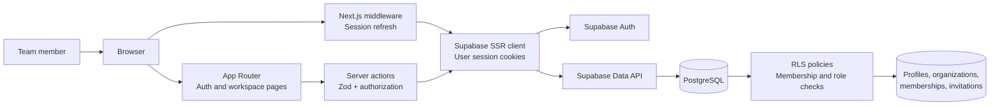
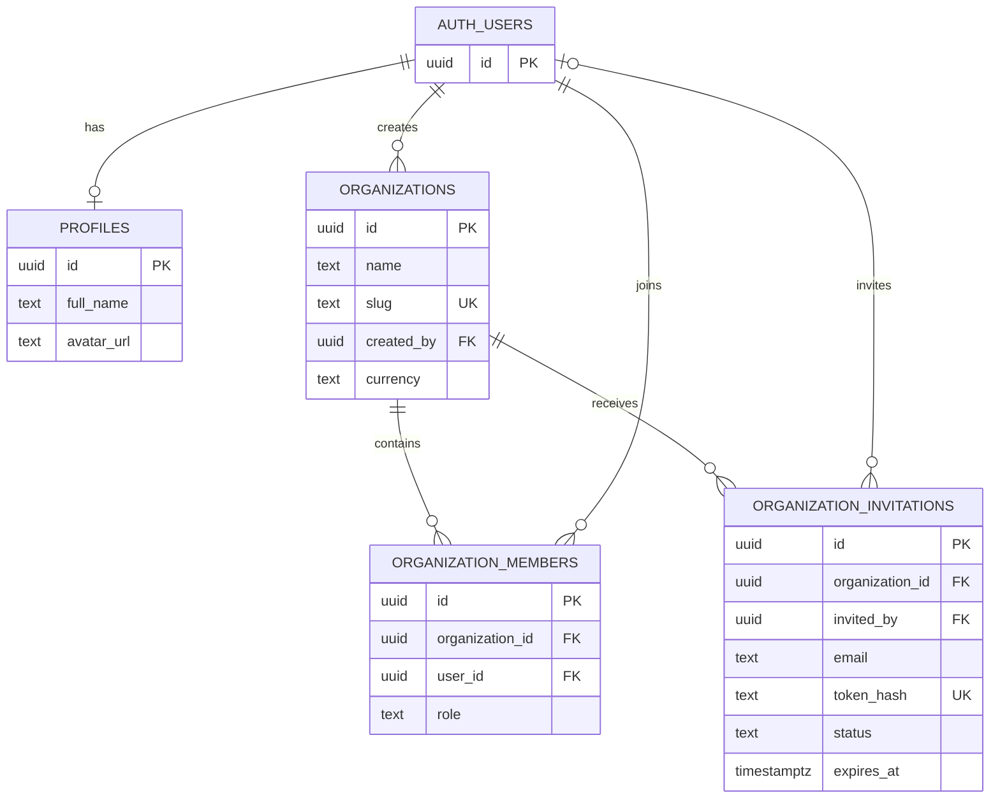

# UpWeGo Architecture

**Status:** Describes the repository as it exists today. The PRD remains the authority for the intended product; this document records the implementation and its boundaries.

## Product and architecture at a glance

UpWeGo is a multi-organization business-management application for small agencies and service businesses. The repository is a Next.js modular monolith: the App Router owns pages and server actions, Supabase provides authentication and PostgreSQL, and database Row Level Security (RLS) is a second access-control boundary. There is no separate API service, ORM, job system, or email provider in the current codebase.

The current delivery status is tracked in [TASK.md](./TASK.md). This document focuses on the architecture and verified database state.



## Technology stack

| Layer           | Technology                                                        | Repository usage                                                                           |
| --------------- | ----------------------------------------------------------------- | ------------------------------------------------------------------------------------------ |
| Web framework   | Next.js `^15.3.4`, React `^19.0.0`                                | App Router pages, layouts, middleware, route handler, and server actions                   |
| Language        | TypeScript `^5.8.3`                                               | Strict type checking; Supabase types are maintained in `src/types/supabase.ts`             |
| UI              | Tailwind CSS `^3.4.17`, Radix UI, shadcn-style components, Lucide | Tokens in `src/app/globals.css`; primitives in `src/components/ui`                         |
| Data and auth   | Supabase JS `^2.50.0`, `@supabase/ssr` `^0.6.1`, PostgreSQL 17    | Auth sessions, Data API queries, and RLS; connected database reported version `17.6.1.166` |
| Validation      | Zod `^3.25.67`                                                    | Server-action input schemas in `src/lib/validations`                                       |
| Feedback/forms  | React state and transitions, Sonner                               | Current forms do not use the installed `react-hook-form` packages                          |
| Quality/tooling | ESLint 9, Prettier 3, npm                                         | Scripts and pinned dependency resolution in `package.json` and `package-lock.json`         |

The actual dependency ranges are in `package.json`; those ranges are not a claim that each package is at its latest release. No service-role key is used by application code. Browser and server Supabase clients both use the public anon key, with access constrained by authenticated sessions and RLS.

## Request and trust boundaries

1. `src/middleware.ts` refreshes Supabase sessions on matched requests and redirects unauthenticated requests for `/dashboard` and `/onboarding`. The shared `(app)` layout also checks the user, so app pages in that route group have a server-side authentication check.
2. `src/lib/supabase/server.ts` creates a request-scoped server client and reads/writes Supabase session cookies. `src/lib/supabase/client.ts` creates the browser client with public configuration only.
3. Server actions in `src/app/actions/` validate submitted values with Zod, load the current user or organization context as needed, and issue database requests through the session client. The browser is not given privileged database credentials.
4. PostgreSQL RLS policies, scoped to authenticated users, constrain profile, organization, membership, and invitation rows. Membership helpers live in a non-exposed private schema. Invitation acceptance is a database RPC that checks verified account email, invitation status/expiry, and email match before adding membership.
5. The active-organization cookie is only a preference. `getActiveOrganizationContext()` first builds the authenticated user's organization list through membership rows, then selects the cookie value only if it matches that list.

Three reviewed SQL migrations have applied to the connected development database. The active-organization cookie is only a preference: the server action checks membership before switching, and the context resolver accepts only organizations found in the signed-in user's membership list. Cookie settings are HttpOnly, SameSite=Lax, and Secure in production. The resolver reads the previous cookie name for existing sessions.

## Current user flows

- `/` checks the Supabase user and redirects to `/dashboard` or `/login`.
- `/register`, `/login`, `/forgot-password`, and `/reset-password` use Supabase Auth through server actions. `/auth/callback` exchanges the auth code for a session.
- `/dashboard` shows the signed-in user, organization summary, and member count. Project/client/revenue figures are hard-coded placeholder values and are not business reporting.
- `/onboarding` creates an organization and an owner membership, then sets the active-organization cookie.
- `/organization/settings` reads organization context and allows owners to update organization details.
- `/team` lists organization memberships and invitations. Owners can change roles/remove members; owners and project managers can generate/revoke invitations subject to action and RLS checks.
- `/invite/[token]` hashes the supplied token and uses a restricted RPC to show invitation details. The invitee signs in or registers, then accepts the invitation. The generated seven-day URL is shown for manual sharing; no email delivery is implemented.
- Sidebar links for clients, projects, tasks, quotations, and payments are disabled placeholders. No routes/data layer for those modules exists.

## Current database model

The original baseline is `supabase/migrations/first.sql`; it defines four public tables. Three incremental Phase 2 migrations record database hardening:

| Migration                                        | Applied result                                                                                                                            |
| ------------------------------------------------ | ----------------------------------------------------------------------------------------------------------------------------------------- |
| `20261011162914_phase2_security_hardening.sql`   | Scopes table policies to authenticated users, removes anonymous table access, fixes function search paths, and restricts function grants. |
| `20261011163056_phase2_private_rls_helpers.sql`  | Moves membership/role helpers into the non-exposed `private` schema and updates RLS policies.                                             |
| `20261011163330_phase2_minimum_table_grants.sql` | Removes excess authenticated table privileges and grants only workflow-required operations.                                               |

| Table                      | Purpose and key relationships                                                                                                       |
| -------------------------- | ----------------------------------------------------------------------------------------------------------------------------------- |
| `profiles`                 | User profile keyed to `auth.users`; a trigger initializes profile data after signup.                                                |
| `organizations`            | Organization/business profile; includes unique slug, currency, and creator.                                                         |
| `organization_members`     | Joins auth users to organizations with a checked role: `owner`, `project_manager`, or `employee`; organization/user pair is unique. |
| `organization_invitations` | Hashed invitation token, recipient, role, lifecycle status, inviter, and expiry; belongs to an organization.                        |

The migration enables RLS on all four tables and adds policies/helpers for profiles, organization membership, organization owners/admins, and invitations. It also creates `get_invitation_by_token` and `accept_invitation` RPCs. `src/types/supabase.ts` is a hand-maintained TypeScript representation of this schema and those functions, not a generated type artifact.

### Live database cross-check

Checked against the connected **UpWeGo - Development** project on 2026-10-11:

| Check            | Live result                                                                                                                                                                                                                                    |
| ---------------- | ---------------------------------------------------------------------------------------------------------------------------------------------------------------------------------------------------------------------------------------------- |
| Public tables    | Exactly `profiles`, `organizations`, `organization_members`, and `organization_invitations`; columns, types, defaults, keys, checks, and indexes match `first.sql`.                                                                            |
| RLS              | Enabled on all four tables. All 13 policies target `authenticated`; UPDATE policies have explicit matching `WITH CHECK` expressions.                                                                                                           |
| Table grants     | `anon` and PUBLIC have no grants on these tables. Authenticated grants are limited to profile/org SELECT, INSERT, UPDATE; membership CRUD; and invitation SELECT, INSERT, UPDATE.                                                              |
| Function grants  | All seven functions have fixed empty `search_path`. Trigger functions have no API execute grant. Three membership helpers are in `private`. Public invitation lookup remains callable by anon/authenticated; acceptance is authenticated-only. |
| Migration ledger | Supabase records the three hardening migrations, and local filenames match remote versions. The baseline ledger was empty before hardening; exact original execution of `first.sql` remains unproven.                                          |

This remains a state comparison, not proof that the checked-in baseline file was the exact SQL originally run. A fresh environment/reset still needs a documented baseline migration and ledger procedure.

### RLS and database review findings

| Priority           | Current live result                                                                                                                                                                                                                                                                                                                  | Remaining action                                                                                                                                                                                                                                                     |
| ------------------ | ------------------------------------------------------------------------------------------------------------------------------------------------------------------------------------------------------------------------------------------------------------------------------------------------------------------------------------ | -------------------------------------------------------------------------------------------------------------------------------------------------------------------------------------------------------------------------------------------------------------------- |
| Resolved           | Anonymous table access and excess authenticated table privileges have been revoked; all table policies explicitly target authenticated requests.                                                                                                                                                                                     |
| Resolved           | RLS membership helpers are private-schema functions. Trigger functions are not API-executable. All function paths are fixed. Remaining security-advisor warnings are intentional: public invitation preview and authenticated invitation lookup/acceptance RPCs.                                                                     |
| Open               | Supabase Auth leaked-password protection remains disabled.                                                                                                                                                                                                                                                                           | Enable in Supabase Auth settings and verify account flows; the connected tool did not expose an Auth settings control. See [password protection guidance](https://supabase.com/docs/guides/auth/password-security#password-strength-and-leaked-password-protection). |
| Performance        | The current advisor reports an unindexed `organization_invitations.invited_by` foreign key and two unused indexes (`idx_organizations_creator`, `idx_org_invitations_email`). The inventory also confirms redundant non-unique indexes on `organizations.slug` and `organization_invitations.token_hash`, covered by unique indexes. | Reassess against representative query patterns before adding or dropping indexes.                                                                                                                                                                                    |
| Migration baseline | The original live schema matched `first.sql` by resulting objects, but its ledger was empty.                                                                                                                                                                                                                                         | Document and verify the baseline process before using clean resets or provisioning another environment.                                                                                                                                                              |

References: [Supabase API grants and RLS security](https://supabase.com/docs/guides/api/securing-your-api), [Supabase UPDATE policy behavior](https://supabase.com/docs/guides/database/postgres/row-level-security#update-policies), [security-definer functions callable by `anon`](https://supabase.com/docs/guides/database/database-linter?lint=0028_anon_security_definer_function_executable), [mutable function `search_path`](https://supabase.com/docs/guides/database/database-linter?lint=0011_function_search_path_mutable), [unindexed foreign keys](https://supabase.com/docs/guides/database/database-linter?lint=0001_unindexed_foreign_keys), and [leaked-password protection](https://supabase.com/docs/guides/auth/password-security#password-strength-and-leaked-password-protection).

The owner reported successful manual Phase 2 tests for organization creation/ownership, invitations, role permissions, rejection of wrong-email and unverified invitees, one-time acceptance, revocation, expiry, and organization relationships. These were not re-run with test accounts after hardening. Live SQL checks verified final grants, policy roles, function ACLs, and fixed function settings. Security advisors now show only the intended invitation RPC warnings plus leaked-password protection. Performance findings are listed above.

There are no client/project/task/milestone/quotation/payment/audit tables, storage buckets, billing tables, or database seed files in the repository. For schema changes, use `supabase migration new <descriptive_name>` to add a file under `supabase/migrations/`, preserve `first.sql`, review the SQL, and apply it to the intended development database. Confirm the recorded version and keep the local filename aligned with it. Tell the owner whether another environment must receive the migration.



## Repository map

```text
.
|-- docs/
|   |-- PRD.md                 # Product scope and outcomes
|   |-- ARCHITECTURE.md        # Runtime, data model, and security review
|   |-- TASK.md                # Phase status and outstanding work
|   `-- MEMORY.md              # Durable handoff decisions
|-- src/
|   |-- app/
|   |   |-- (app)/             # Workspace routes and authenticated shell
|   |   |-- (auth)/            # Auth and invitation routes
|   |   |-- actions/            # Auth, organization, and invitation server actions
|   |   `-- auth/callback/      # Supabase auth code exchange
|   |-- components/
|   |   |-- auth/               # Auth forms
|   |   |-- layout/             # Sidebar and user menu
|   |   |-- organization/       # Organization forms
|   |   |-- team/               # Team and invitation UI
|   |   `-- ui/                 # Shared Radix/shadcn-style primitives
|   |-- lib/
|   |   |-- organization/       # Membership-scoped active organization context
|   |   |-- supabase/           # Browser, server, and middleware clients
|   |   |-- validations/        # Zod schemas
|   |   `-- utils.ts            # Tailwind class utility
|   |-- types/supabase.ts       # Hand-maintained DB/function types
|   `-- middleware.ts           # Session refresh and route redirects
|-- supabase/migrations/
|   |-- first.sql               # Original baseline schema, functions, triggers, and RLS
|   |-- 20261011162914_phase2_security_hardening.sql
|   |-- 20261011163056_phase2_private_rls_helpers.sql
|   `-- 20261011163330_phase2_minimum_table_grants.sql
|-- .env.example                # Public Supabase variable names only
|-- package.json                # Scripts and dependency declarations
`-- package-lock.json           # npm dependency lockfile
```

There is no dedicated `services/`, `repositories/`, or `hooks/` implementation today. Server actions call the Supabase client directly; keep that approach simple until repeated business logic justifies a new layer. Route groups `(app)` and `(auth)` organize layouts without adding URL segments.

## Local configuration and commands

Copy `.env.example` to `.env.local` and set `NEXT_PUBLIC_SUPABASE_URL` and `NEXT_PUBLIC_SUPABASE_ANON_KEY` from the intended Supabase project. Configure the Supabase Auth redirect URLs for the local/deployed app and apply the initial migration only after confirming the database state. Never commit `.env.local` or a service-role secret.

```bash
npm install
npm run dev
npm run lint
npm run build
```

These are the commands declared by the project scripts. This documentation pass did not run them. There is no test script or test suite in the current repository.

## Documentation ownership

Use [TASK.md](./TASK.md) for feature completion and open work. Use [MEMORY.md](./MEMORY.md) for durable decisions and the handoff point. This file stays focused on the actual code/data architecture and live Supabase review.
