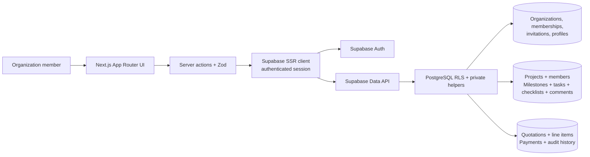
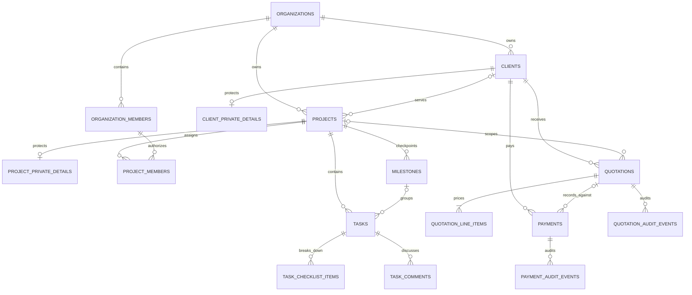

# UpWeGo Architecture

**Status:** Application code reviewed on 2026-11-08. Phase 4 and Phase 5 migrations are prepared locally and have not been applied to the connected Development database. Product scope remains in [PRD.md](./PRD.md); progress and open verification are in [TASK.md](./TASK.md).

## System overview

UpWeGo is a Next.js modular monolith. App Router pages render the workspace, server actions validate and authorize mutations, and Supabase PostgreSQL RLS remains the tenant and record access boundary. No ORM, separate API service, or privileged service-role client is used by the app.



## Technology stack

| Layer      | Technology                                                 | Use                                                                             |
| ---------- | ---------------------------------------------------------- | ------------------------------------------------------------------------------- |
| Web        | Next.js 15, React 19                                       | App Router layouts/pages, middleware, server actions                            |
| Language   | TypeScript 5, strict mode                                  | Application types in `src/types/supabase.ts`                                    |
| UI         | Tailwind CSS, Radix UI, shadcn-style primitives, Lucide    | Responsive workspace and accessible controls                                    |
| Data/auth  | Supabase JS, `@supabase/ssr`, PostgreSQL 17, Supabase Auth | Cookie-backed sessions, Data API, database authorization                        |
| Validation | Zod                                                        | Server-side task, milestone, quotation, payment, client, and project validation |
| Quality    | ESLint 9, Prettier 3, npm                                  | Lint/build/format scripts                                                       |

Dependency ranges are recorded in `package.json`. The app uses public Supabase URL/anon configuration with the signed-in session. No service-role key is used in app code.

## Request and authorization flow

1. Middleware refreshes Supabase sessions; server components share one request-scoped verified user lookup through React `cache`.
2. `getActiveOrganizationContext()` loads the signed-in user's memberships and related organizations in one query, then accepts the active-org cookie only when it matches a current membership.
3. Server actions parse form input with Zod, derive organization and actor IDs from authenticated context, and check project permissions before mutation. Project creation generates its UUID server-side and inserts without `RETURNING`: PostgREST's `INSERT ... RETURNING` also applies the SELECT policy, and the project visibility helper cannot see the not-yet-visible row within that same statement.
4. RLS policies independently scope records to the current organization and authorized project membership. Composite tenant foreign keys prevent cross-organization relationships. Task actions also enforce project manager, task manager, and assignee boundaries.
5. Sensitive client and project data are in separate tables with stricter RLS, so hiding a field in the UI is not the security boundary.
6. Financial mutations require an Owner or Project Manager. Quotation line items are saved atomically through an authenticated `SECURITY INVOKER` RPC; payment and quotation audit events are written by fixed-search-path database triggers.

## Current routes and modules

| Route                                                                          | Purpose                                                                                                  |
| ------------------------------------------------------------------------------ | -------------------------------------------------------------------------------------------------------- |
| `/register`, `/login`, `/forgot-password`, `/reset-password`, `/auth/callback` | Supabase Auth                                                                                            |
| `/onboarding`, `/organization/settings`, `/team`, `/invite/[token]`            | Organizations, roles, invitations                                                                        |
| `/dashboard`                                                                   | Organization/member summary, RLS-filtered counts, and persisted payment totals grouped by currency       |
| `/clients`, `/clients/new`, `/clients/[id]`, `/clients/[id]/edit`              | Client list, search/filter, detail, create/edit, archive/restore                                         |
| `/projects`, `/projects/new`, `/projects/[id]`, `/projects/[id]/edit`          | Project list/filter, create/edit, team assignment and per-project access                                 |
| `/tasks`, `/tasks/new`, `/tasks/[id]`, `/tasks/[id]/edit`                      | Project task filters, assignment, due dates, status, checklist ordering, discussion, and task management |
| `/quotations`, `/quotations/new`, `/quotations/[id]`, `/quotations/[id]/edit`  | Quote drafts, calculated line items, statuses, duplicate/archive/delete, and client-linked history       |
| `/quotations/[id]/print`, `/quotations/history`                                | Organization-branded print/PDF preview and persistent quotation audit history                            |
| `/payments`, `/payments/new`, `/payments/[id]`, `/payments/[id]/edit`          | Manual payment recording, currency-aware totals, editing, and deletion                                   |
| `/payments/history`                                                            | Persistent payment creation, update, and deletion audit history                                          |

Invitation email delivery is not implemented; owners share links manually. Quotations export on demand through the browser print dialog, so UpWeGo does not keep generated files.

Workspace routes use `src/app/(app)/loading.tsx` as a server-navigation fallback. `WorkspaceRouteTransition` also hides the previous page and displays the skeleton immediately after an internal link click while the next route loads. Independent Team-page member and invitation queries run concurrently.

## Data model

The original `supabase/migrations/first.sql` remains untouched. Phase 2 has three hardening migrations. Phase 3 migrations applied to UpWeGo - Development are:

| Migration                                           | Result                                                                                                                                                      |
| --------------------------------------------------- | ----------------------------------------------------------------------------------------------------------------------------------------------------------- |
| `20261011170350_phase3_clients_projects.sql`        | Five RLS-enabled tables, tenant constraints/indexes, RLS policies, fixed-search-path project access helpers and minimum grants                              |
| `20261011170600_phase3_project_access_controls.sql` | Corrects sensitive access checks and creates creator membership atomically for newly created projects                                                       |
| `20261012141701_project_creator_rls.sql`            | Assigns project creator from database `auth.uid()` and restricts inserts to organization admins through RLS                                                 |
| `20261108052434_phase4_tasks_milestones.sql`        | Prepared locally; task/milestone tables, project task permissions, checklist ordering RPC, timestamp guards, and RLS; pending owner application             |
| `20261108052448_phase5_quotations_payments.sql`     | Prepared locally; quotations, line items, payments, atomic numbering/save, currency-aware totals, audit history, grants, and RLS; pending owner application |

| Table                      | Role                                                                                                |
| -------------------------- | --------------------------------------------------------------------------------------------------- |
| `profiles`                 | Profile data linked to Supabase Auth                                                                |
| `organizations`            | Tenant/business workspace and currency                                                              |
| `organization_members`     | Organization/user membership with Owner, Project Manager, Employee role                             |
| `organization_invitations` | Hashed, expiring/revocable invitation records                                                       |
| `clients`                  | Organization-scoped contact/business data, archive timestamp                                        |
| `client_private_details`   | Tax/business ID and internal notes; Owner/Project Manager only                                      |
| `projects`                 | Organization-scoped delivery record, client link, status, priority, dates, visibility               |
| `project_members`          | Per-project assignment, PM flag, and view/edit/member/task/milestone/info/sensitive permissions     |
| `project_private_details`  | Project value and technical/internal data; separate RLS                                             |
| `milestones`               | Project checkpoints with status and due date; progress is derived from associated tasks             |
| `tasks`                    | Project work with optional milestone/assignee, status, priority, due/completion timestamps          |
| `task_checklist_items`     | Ordered task checklist; the assignee can complete items, task managers can reorder/manage them      |
| `task_comments`            | Project-scoped task discussion authored by organization/project viewers                             |
| `quotations`               | Organization/client/project quote document, status, issue-year number, terms, and currency snapshot |
| `quotation_line_items`     | Ordered quantities, prices, discounts, and tax rates; totals are calculated from persisted rows     |
| `quotation_audit_events`   | Manager-only quote create/edit/status/archive/delete history; retained after quote deletion         |
| `payments`                 | Manual client/project/quote payment record with currency snapshot and recorded-by actor             |
| `payment_audit_events`     | Manager-only payment create/edit/delete history; retained after payment deletion                    |



Composite foreign keys pair every client/project/member reference with `organization_id`; project/client and membership relationships cannot cross tenants. Checks enforce valid status, priority, visibility, project date ordering, nonnegative project value, and sensible permission combinations. Project deletion cascades its members/private details. Client deletion is restricted while projects refer to it; archiving preserves history.

Tasks and milestones are organization scoped and use `(organization_id, project_id)` foreign keys; a task's milestone must belong to the same project. Deleting a milestone clears the task's milestone link, while deleting a project removes its milestones/tasks/checklists/comments. Project capabilities imply project visibility so an authorized task or milestone manager can use the operational pages. Milestone completion percentages are computed from completed task rows rather than stored redundantly.

Quotation numbers are allocated with a per-organization, per-issue-year counter row that is updated atomically. A draft's issue year cannot change after its number is assigned. Issued quotation contents and line items are locked; legal status transitions remain available to managers. Deleting a draft is audited. Payments snapshot currency; a payment linked to a quotation must use that quotation's currency. Payment/quotation audit rows do not have a cascading foreign key to their source record, so deletion history remains readable.

Project creation uses an authenticated Owner or Project Manager RLS check. A `BEFORE INSERT` trigger assigns `created_by` from the database JWT so the application cannot choose another creator.

## Permission model

| Actor           | Clients                                    | Organization-wide projects      | Restricted projects                                       | Sensitive project fields                         |
| --------------- | ------------------------------------------ | ------------------------------- | --------------------------------------------------------- | ------------------------------------------------ |
| Owner           | Read/write/archive; private client details | Full access                     | Full access                                               | Full access                                      |
| Project Manager | Read/write/archive; private client details | Access under project permission | Assigned access, with creator's scoped project membership | Project manager or explicit sensitive permission |
| Employee        | Read client contact records                | Visible to organization members | Only when assigned `can_view`                             | Only when assigned `can_access_sensitive`        |

| Actor           | Tasks and milestones                                                                                                                                | Quotations and payments                                                             |
| --------------- | --------------------------------------------------------------------------------------------------------------------------------------------------- | ----------------------------------------------------------------------------------- |
| Owner           | Full organization access                                                                                                                            | Read/write/archive; audit history                                                   |
| Project Manager | Project creator or assigned project manager/task/milestone capability; assignee can change task status/checklist completion                         | Full organization finance access, matching the established `is_org_admin` role rule |
| Employee        | Can view tasks under their project visibility; assignees can update task status and checklist completion; managers control task/milestone structure | No quotation, payment, or finance audit access                                      |

Project record edits require Owner, assigned project manager, or `can_edit`. Member/visibility management requires Owner or designated project manager/member-management authority; visibility changes are restricted to Owner/Project Manager. Editing private project information requires Owner, project manager, or `can_edit_info`. Phase 4 adds explicit Owner, project creator Project Manager, assigned Project Manager, and `can_manage_tasks`/`can_manage_milestones` checks. Task assignees may change task status and checklist completion only; they cannot change assignment or task details.

## Repository map

```text
docs/                       PRD, architecture, phase tracker, durable memory
src/app/(auth)/             Auth and invitation routes
src/app/(app)/              Authenticated workspace; clients and projects included
src/app/actions/            Auth, organization, invitation, client/project, task, quotation, and payment server actions
src/components/ui/          Shared Radix/shadcn-style primitives
src/components/clients-projects/ Shared record form UI
src/components/work-management/ Task and milestone forms
src/components/financial/    Quotation line editor, payment forms, print action, confirmation button
src/lib/organization/       Authenticated active-organization context
src/lib/supabase/           Browser, server, and middleware clients
src/lib/validations/        Zod input schemas for organization and business workflows
src/types/supabase.ts       Hand-maintained database type declarations
supabase/migrations/        Original baseline plus timestamped incremental migrations
```

Server actions currently call the Supabase session client directly. Add a service/repository layer only when repeated logic warrants one.

## Live verification and open issues

The Phase 2/3 database state described above reflects the previous Development review. This implementation turn did not inspect or modify the connected database. The two new SQL files are pending owner application; their RLS, constraints, triggers, grants, and helper functions therefore are not active in Development yet. Do not use the new routes against Development until both migrations are applied in timestamp order.

`npx tsc --noEmit`, `npm run lint`, and `npm run build` passed for the expanded app; Prettier status is recorded in [TASK.md](./TASK.md). Lint prints the existing Next.js `next lint` deprecation notice but has no warnings or errors. The Supabase session client still uses a narrow typed query surface over the hand-maintained database declarations. Browser workflows, RLS boundaries, and Auth/organization/invitation regressions were not run because no authenticated test sessions were available; the database migrations remain pending.

For future database changes, generate a new file using `supabase migration new <name>`, review it, apply through the established Development workflow, confirm its remote ledger version, and align the local filename. Never rewrite `first.sql` or make direct untracked schema changes.
