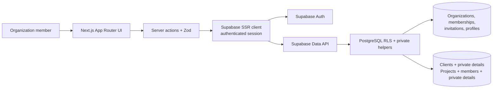
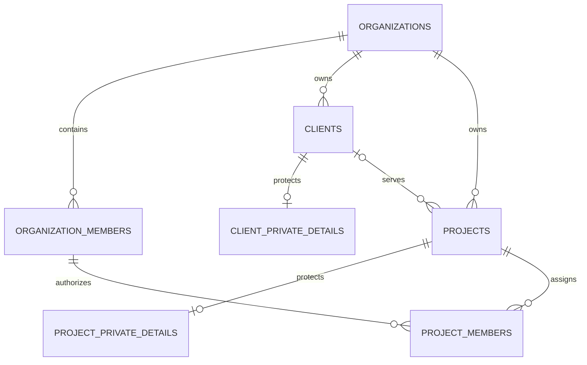

# UpWeGo Architecture

**Status:** Current code and connected Development database as checked on 2026-10-11. Product scope remains in [PRD.md](./PRD.md); progress and open verification are in [TASK.md](./TASK.md).

## System overview

UpWeGo is a Next.js modular monolith. App Router pages render the workspace, server actions validate and authorize mutations, and Supabase PostgreSQL RLS remains the tenant and record access boundary. No ORM, separate API service, or privileged service-role client is used by the app.



## Technology stack

| Layer      | Technology                                                 | Use                                                      |
| ---------- | ---------------------------------------------------------- | -------------------------------------------------------- |
| Web        | Next.js 15, React 19                                       | App Router layouts/pages, middleware, server actions     |
| Language   | TypeScript 5, strict mode                                  | Application types in `src/types/supabase.ts`             |
| UI         | Tailwind CSS, Radix UI, shadcn-style primitives, Lucide    | Responsive workspace and accessible controls             |
| Data/auth  | Supabase JS, `@supabase/ssr`, PostgreSQL 17, Supabase Auth | Cookie-backed sessions, Data API, database authorization |
| Validation | Zod                                                        | Server-side client and project input validation          |
| Quality    | ESLint 9, Prettier 3, npm                                  | Lint/build/format scripts                                |

Dependency ranges are recorded in `package.json`. The app uses public Supabase URL/anon configuration with the signed-in session. No service-role key is used in app code.

## Request and authorization flow

1. Middleware refreshes Supabase sessions; the authenticated `(app)` layout checks the current user.
2. `getActiveOrganizationContext()` accepts the active-org cookie only when the user is a current member.
3. Server actions parse form input with Zod, derive organization and actor IDs from authenticated context, and check project permissions before mutation.
4. RLS policies independently scope records to the current organization and authorized project membership. Composite tenant foreign keys prevent cross-organization relationships.
5. Sensitive client and project data are in separate tables with stricter RLS, so hiding a field in the UI is not the security boundary.

## Current routes and modules

| Route                                                                          | Purpose                                                                                                   |
| ------------------------------------------------------------------------------ | --------------------------------------------------------------------------------------------------------- |
| `/register`, `/login`, `/forgot-password`, `/reset-password`, `/auth/callback` | Supabase Auth                                                                                             |
| `/onboarding`, `/organization/settings`, `/team`, `/invite/[token]`            | Organizations, roles, invitations                                                                         |
| `/dashboard`                                                                   | Organization/member summary and RLS-filtered client/project counts; revenue remains a Phase 5 placeholder |
| `/clients`, `/clients/new`, `/clients/[id]`, `/clients/[id]/edit`              | Client list, search/filter, detail, create/edit, archive/restore                                          |
| `/projects`, `/projects/new`, `/projects/[id]`, `/projects/[id]/edit`          | Project list/filter, create/edit, team assignment and per-project access                                  |

Tasks, milestones, quotations, payments, notifications, and audit history remain future work. Invitation email delivery is not implemented; owners share links manually.

## Data model

The original `supabase/migrations/first.sql` remains untouched. Phase 2 has three hardening migrations. Phase 3 migrations applied to UpWeGo - Development are:

| Migration                                           | Result                                                                                                                         |
| --------------------------------------------------- | ------------------------------------------------------------------------------------------------------------------------------ |
| `20261011170350_phase3_clients_projects.sql`        | Five RLS-enabled tables, tenant constraints/indexes, RLS policies, fixed-search-path project access helpers and minimum grants |
| `20261011170600_phase3_project_access_controls.sql` | Corrects sensitive access checks and creates creator membership atomically for newly created projects                          |

| Table                      | Role                                                                                            |
| -------------------------- | ----------------------------------------------------------------------------------------------- |
| `profiles`                 | Profile data linked to Supabase Auth                                                            |
| `organizations`            | Tenant/business workspace and currency                                                          |
| `organization_members`     | Organization/user membership with Owner, Project Manager, Employee role                         |
| `organization_invitations` | Hashed, expiring/revocable invitation records                                                   |
| `clients`                  | Organization-scoped contact/business data, archive timestamp                                    |
| `client_private_details`   | Tax/business ID and internal notes; Owner/Project Manager only                                  |
| `projects`                 | Organization-scoped delivery record, client link, status, priority, dates, visibility           |
| `project_members`          | Per-project assignment, PM flag, and view/edit/member/task/milestone/info/sensitive permissions |
| `project_private_details`  | Project value and technical/internal data; separate RLS                                         |



Composite foreign keys pair every client/project/member reference with `organization_id`; project/client and membership relationships cannot cross tenants. Checks enforce valid status, priority, visibility, project date ordering, nonnegative project value, and sensible permission combinations. Project deletion cascades its members/private details. Client deletion is restricted while projects refer to it; archiving preserves history.

## Permission model

| Actor           | Clients                                    | Organization-wide projects      | Restricted projects                                       | Sensitive project fields                         |
| --------------- | ------------------------------------------ | ------------------------------- | --------------------------------------------------------- | ------------------------------------------------ |
| Owner           | Read/write/archive; private client details | Full access                     | Full access                                               | Full access                                      |
| Project Manager | Read/write/archive; private client details | Access under project permission | Assigned access, with creator's scoped project membership | Project manager or explicit sensitive permission |
| Employee        | Read client contact records                | Visible to organization members | Only when assigned `can_view`                             | Only when assigned `can_access_sensitive`        |

Project record edits require Owner, assigned project manager, or `can_edit`. Member/visibility management requires Owner or designated project manager/member-management authority; visibility changes are restricted to Owner/Project Manager. Editing private project information requires Owner, project manager, or `can_edit_info`. Specific task/milestone flags are stored now for Phase 4; those modules are not implemented yet.

## Repository map

```text
docs/                       PRD, architecture, phase tracker, durable memory
src/app/(auth)/             Auth and invitation routes
src/app/(app)/              Authenticated workspace; clients and projects included
src/app/actions/            Auth, organization, invitation, client, project server actions
src/components/ui/          Shared Radix/shadcn-style primitives
src/components/clients-projects/ Shared record form UI
src/lib/organization/       Authenticated active-organization context
src/lib/supabase/           Browser, server, and middleware clients
src/lib/validations/        Zod input schemas
src/types/supabase.ts       Hand-maintained database type declarations
supabase/migrations/        Original baseline plus timestamped incremental migrations
```

Server actions currently call the Supabase session client directly. Add a service/repository layer only when repeated logic warrants one.

## Live verification and open issues

Development database reports nine public tables with RLS enabled. The two Phase 3 migration versions match the remote ledger; the baseline ledger history remains unproven. Supabase advisors reported no new Phase 3 security findings. Existing findings remain for intended invitation RPC execute grants and disabled leaked-password protection. Performance advisor reports the existing unindexed invitation `invited_by` foreign key; unused Phase 3 indexes are expected before representative table data exists. Do not remove indexes based only on the empty development workload.

`npm run lint`, `npx tsc --noEmit`, `npm run build`, and Prettier checks completed successfully; lint retains the Next.js `next lint` deprecation notice. The server Supabase helper provides a narrow typed query surface over the local row/insert/update definitions and preserves the authenticated Supabase client for auth/RPC operations. Phase 3 authenticated workflow and cross-organization tests were not run; Phase 1/2 end-to-end flows were not rerun because connected database tooling does not provide app test-account sessions. See [TASK.md](./TASK.md) for outstanding verification.

For future database changes, generate a new file using `supabase migration new <name>`, review it, apply through the established Development workflow, confirm its remote ledger version, and align the local filename. Never rewrite `first.sql` or make direct untracked schema changes.
